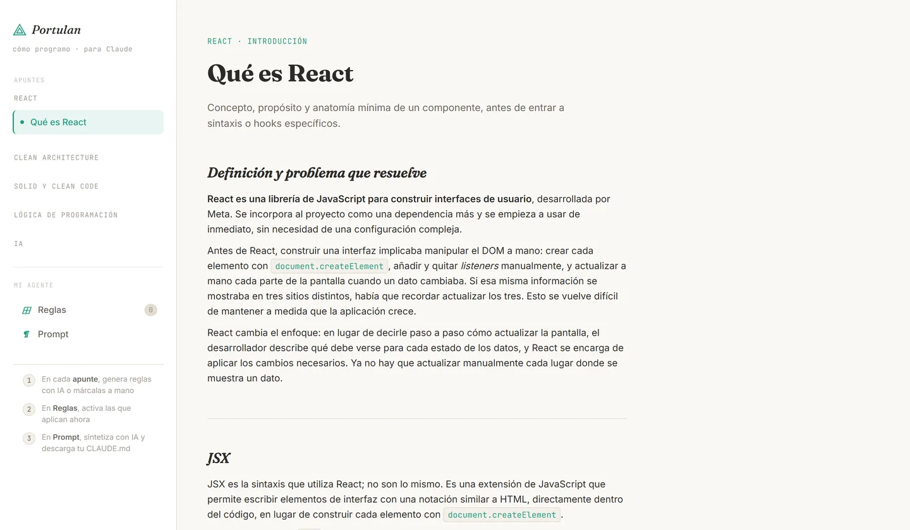
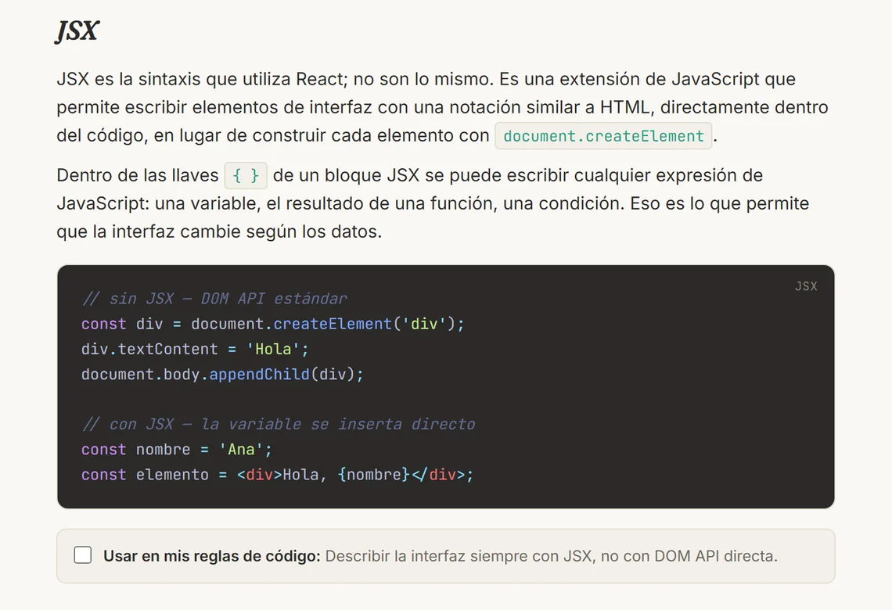
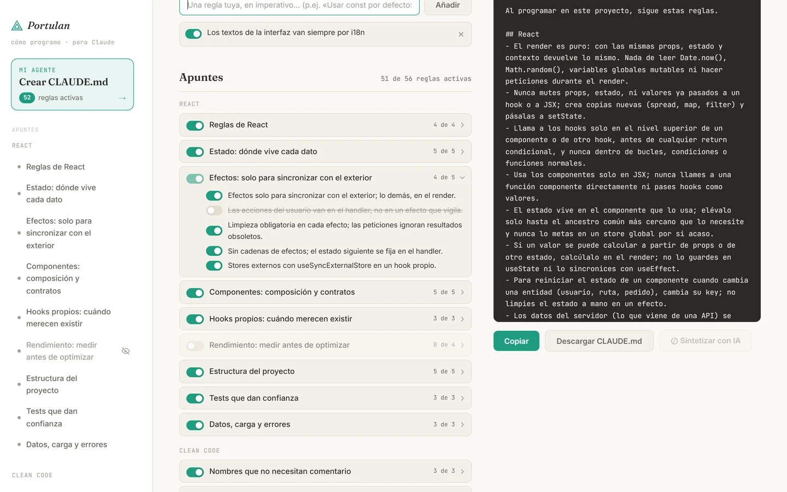

<div align="center">

# ⚓ Portulan

**Apuntes de código estructurados. Para aprender tú, para calibrar la IA.**

[](https://astro.build)
[](https://mdxjs.com)
[](https://typescriptlang.org)
[](https://shiki.style)


</div>

---

**Pruébalo:** [portulan-six.vercel.app](https://portulan-six.vercel.app)



> *Un portulano es una carta náutica medieval: trazada por quien ya navegó esas aguas, para no perderse dos veces.*
> **Portulan es tu carta de código.**

<br />

## ¿Qué es Portulan?

Portulan tiene dos caras y un solo propósito: que el conocimiento que adquieres mientras estudias acabe siendo útil también cuando programas con IA.

| | |
|---|---|
| 📚 **Cuaderno personal** | Apuntes de código profesionales, sin introducciones de manual: React tal como se exige en equipos grandes, Clean Code y SOLID. Cada concepto con su ejemplo mal / bien y la regla que sale de él. |
| 🤖 **Calibrador de IA** | Cada apunte tiene una regla que puedes activar. Las reglas seleccionadas se convierten en un prompt que le dice a Claude (o cualquier IA) exactamente cómo programar **a tu manera**. |

El objetivo no es usar la IA genérica. Es conseguir que la IA programe como tú.

<br />

## Cómo funciona


1. **Lees** el apunte de un tema. Todas sus reglas entran de serie en tu prompt
2. **Apagas** lo que no vaya contigo: el ojo de cada apunte en el menú apaga el apunte entero; la casilla de cada concepto, una regla suelta. No hace falta marcar nada para empezar
3. **En «Mi agente»** el `CLAUDE.md` aparece al instante, por secciones (React, Clean Code, SOLID). A la izquierda, tus reglas propias y los apuntes plegados con su interruptor y su «4 de 5»
4. **Copias o descargas** el resultado, o pides a la IA (con tu API key) que lo redacte como un prompt fluido en vez de una lista





<br />

## Qué trae de serie

Catorce apuntes y 56 reglas que entran de serie en tu CLAUDE.md. Nada de «qué es React»: lo que se pide en una revisión de código de un equipo grande.

| Grupo | Apuntes |
|---|---|
| **React** | Reglas de React · Estado: dónde vive cada dato · Efectos: solo para sincronizar con el exterior · Componentes: composición y contratos · Hooks propios · Rendimiento: medir antes de optimizar · Estructura del proyecto · Tests que dan confianza · Datos, carga y errores |
| **Clean Code** | Nombres · Funciones pequeñas con un solo nivel · Comentarios y documentación · Formato, tamaño y orden |
| **SOLID** | Los cinco principios aplicados a componentes de React, con ejemplo mal / bien en cada uno |

Cada regla está escrita para el prompt: imperativa, una sola decisión, comprobable al leer un diff, con la excepción dentro cuando la hay. El `CLAUDE.md` sale por secciones (React, Clean Code, SOLID). Apaga las que no sean tuyas y añade las que te falten: para eso es un fork.

<br />

## Features

### ✅ Disponibles ahora

- **Apuntes en MDX** — markdown limpio con componentes Astro reutilizables para reglas, notas y código
- **Sidebar dinámico** — se genera automáticamente al crear un nuevo archivo `.mdx`; no hay que configurar nada
- **Mi agente** — apuntes y reglas a la izquierda, `CLAUDE.md` en vivo a la derecha; un ojo en el menú apaga un apunte entero; todo persiste en `localStorage`
- **Syntax highlighting** — Shiki con Material Theme Palenight en build time, sin JavaScript extra
- **Sin servidor** — 100% estático, desplegable en Vercel o Netlify en segundos

### 🔜 Roadmap

| Feature | Descripción | Estado |
|---------|-------------|--------|
| 🔥 **El Forge** | Con tu propia API key de Anthropic en `.env` (`ANTHROPIC_API_KEY`), las reglas activas van a Claude y vuelven como un prompt redactado, por grupos. También puede proponer reglas nuevas leyendo los apuntes. **Solo en local:** la llamada sale del navegador y la clave quedaría escrita en el HTML; no pongas esa variable en Vercel ni en ningún despliegue público. | Disponible en local |
| 📄 **Formatos de export** | El mismo set de reglas exportado como `CLAUDE.md`, `.cursorrules`, system prompt o markdown plano según dónde lo vayas a usar. | Próximo |
| 🧭 **Modos de contexto** | Las mismas reglas producen prompts distintos según el momento: *Nuevo proyecto*, *Code review*, *Refactor*, *Daily use*. | Planificado |
| ✍️ **Reglas custom en UI** | Añade tus propias reglas desde la interfaz sin tocar código. Se guardan en `localStorage`. | Planificado |
| 🧩 **Skill de Claude Code** | El paso automático. En vez de marcar reglas a mano, la skill lee tu repositorio, deduce cómo estructuras el código, qué componentes y tests reutilizas, y deja al agente educado. Portulan es la versión manual; la skill, la automática. | En desarrollo |
| 🔗 **Perfiles exportables** | Exporta e importa tu set de reglas como JSON. Para compartir con tu equipo o hacer backup de tu configuración. | Planificado |

<br />

## Stack

[](https://astro.build)
[](https://mdxjs.com)
[](https://typescriptlang.org)
[](https://shiki.style)

Sin base de datos · Sin backend · Sin dependencias de runtime · Todo en el cliente

<br />

## Crea tu propio Portulan

Portulan está diseñado para ser forkeado. Estos son **tus** apuntes, con **tus** reglas.

```bash
# 1. Haz fork de este repo en GitHub

# 2. Clona e instala
git clone https://github.com/emepuchades/portulan
cd portulan
npm install

# 3. Arranca
npm run dev
# → http://localhost:4321
```

<br />

### Añadir un apunte nuevo

<details>
<summary><b>Ver instrucciones paso a paso</b></summary>

<br />

Crea un archivo `.mdx` en `src/content/posts/`:

```
src/content/posts/mi-apunte.mdx
```

Añade el frontmatter y el contenido:

```mdx
---
eyebrow: CLEAN CODE · FUNCIONES
title: Funciones puras
intro: Qué son, por qué importan y cuándo usarlas.
group: Clean Code
order: 1
---

<Concept title="Definición">

Una función pura siempre retorna el mismo resultado para los mismos
argumentos y no produce efectos secundarios.

```js
// impura — depende de estado externo
let tax = 0.21;
const price = (base) => base * (1 + tax);

// pura — todo lo que necesita lo recibe como argumento
const price = (base, tax) => base * (1 + tax);
```

<RuleCheck rule="Preferir funciones puras; aislar efectos secundarios en los bordes del sistema">
  **Usar en mis reglas:** Funciones puras por defecto; efectos secundarios explícitos.
</RuleCheck>

</Concept>
```

El post aparece automáticamente en el sidebar bajo el grupo `Clean Code`. No hay que registrarlo ni tocar ningún otro archivo.

</details>

### Borrar apuntes que no te sirven

Borra el archivo `.mdx` de `src/content/posts/`. Desaparece del sidebar automáticamente.

<br />

## Despliega el tuyo

<a href="https://vercel.com/new">
  
</a>

```bash
# O desde la CLI de Vercel
npx vercel
```

<br />

## Licencia

[MIT](LICENSE) · Hecho por [María Puchades](https://github.com/emepuchades)

<br />

---

<div align="center">

*Trazado para no perderse dos veces.*

⚓

</div>
